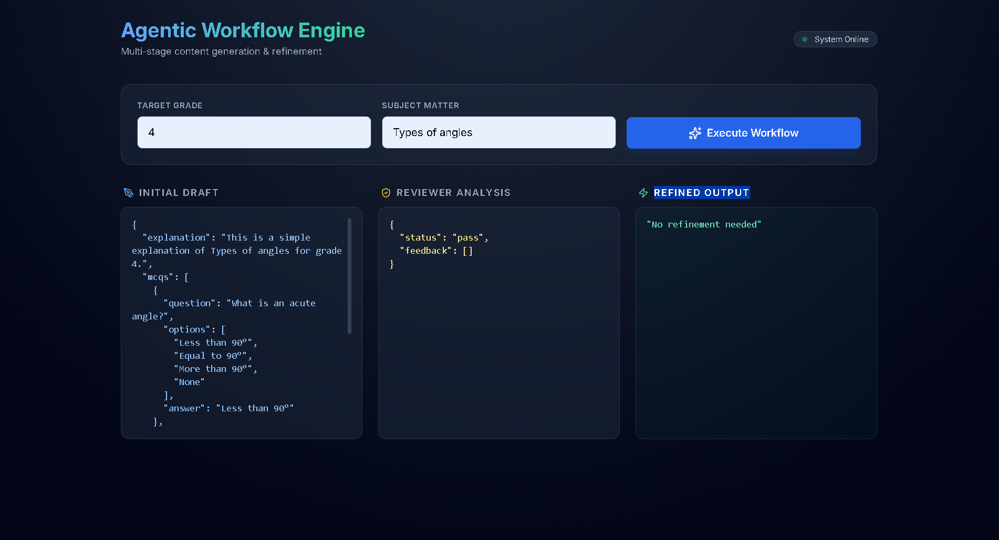
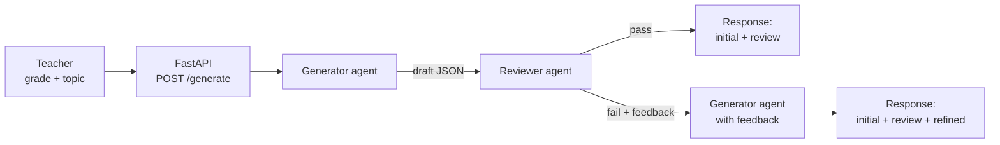

# 🤖 AI Agent Education System

A **multi-agent pipeline** that creates grade-appropriate study material: a short explanation plus multiple-choice questions for any topic. A **Generator agent** writes the content, a **Reviewer agent** checks it against quality rules, and failed content is sent back with feedback for a **refinement** pass.

Backend in **FastAPI**; the front end is a single-page dashboard built with **Tailwind CSS** that shows all three stages side by side.




---

## Why agents?

One LLM call often produces content that is too long, uses words that are too hard for young students, or returns badly formed quiz questions. Splitting the job into **generate → review → refine** gives each step one clear responsibility and makes quality checks explicit, testable and easy to extend.

## Architecture



### Agents

| Agent | Responsibility |
|---|---|
| **Generator** (`backend/agents/generator.py`) | Produces structured JSON: an `explanation` and a list of `mcqs` (question, 4 options, answer). Accepts optional reviewer `feedback` for the refinement pass. |
| **Reviewer** (`backend/agents/reviewer.py`) | Rule-based quality gate returning `{ status: "pass" \| "fail", feedback: [...] }` |

### Reviewer rules

1. **Length**: explanation must be ≤ 100 words for the grade level
2. **Vocabulary**: flags words that are too complex for younger students (e.g. _"consequently"_, _"furthermore"_)
3. **Quantity**: at least 2 MCQs
4. **Structure**: every MCQ needs a question, an answer and exactly 4 options

## API

### `POST /generate`

```bash
curl -X POST http://127.0.0.1:8000/generate \
  -H "Content-Type: application/json" \
  -d '{"grade": 5, "topic": "Angles"}'
```

```json
{
  "initial": {
    "explanation": "This is a simple explanation of Angles for grade 5.",
    "mcqs": [
      {
        "question": "What is an acute angle?",
        "options": ["Less than 90°", "Equal to 90°", "More than 90°", "None"],
        "answer": "Less than 90°"
      }
    ]
  },
  "review": { "status": "pass", "feedback": [] }
}
```

When the review fails, the response also includes a `refined` object produced with the reviewer's feedback.

`GET /` is a health check. Interactive docs are at **http://127.0.0.1:8000/docs** (Swagger UI, generated by FastAPI).

## Run it locally

```bash
git clone https://github.com/JayantBansal900/ai-agent-education-system.git
cd ai-agent-education-system

python -m venv venv
# Windows: venv\Scripts\activate   |   macOS/Linux: source venv/bin/activate
pip install -r requirements.txt

# Start the API from the project root
python -m uvicorn backend.main:app --reload
```

Then open `frontend/index.html` in your browser, enter a grade and a topic, and click **Execute Workflow**.

## Project structure

```
ai-agent-education-system/
├── backend/
│   ├── main.py              # FastAPI app + orchestration (generate → review → refine)
│   └── agents/
│       ├── generator.py     # Generator agent
│       └── reviewer.py      # Rule-based reviewer agent
├── frontend/
│   ├── index.html           # Tailwind dashboard (draft / review / refined panels)
│   └── Demo.png
└── requirements.txt
```

## Current status & roadmap

The orchestration, reviewer and UI are complete. The generator currently returns **template content** so the full pipeline can be run and tested without an API key.

- [ ] Connect the Generator to an LLM (OpenAI is already in `requirements.txt`) using a JSON-schema prompt
- [ ] Feed reviewer feedback into the LLM prompt for real refinement
- [ ] Use an LLM-as-judge reviewer alongside the rule checks (factual accuracy, answer correctness)
- [ ] Readability scoring (e.g. Flesch-Kincaid) mapped to grade level
- [ ] Unit tests for the reviewer rules
- [ ] Restrict CORS origins for deployment

## Author

**Jayant Bansal** · [GitHub](https://github.com/JayantBansal900)
